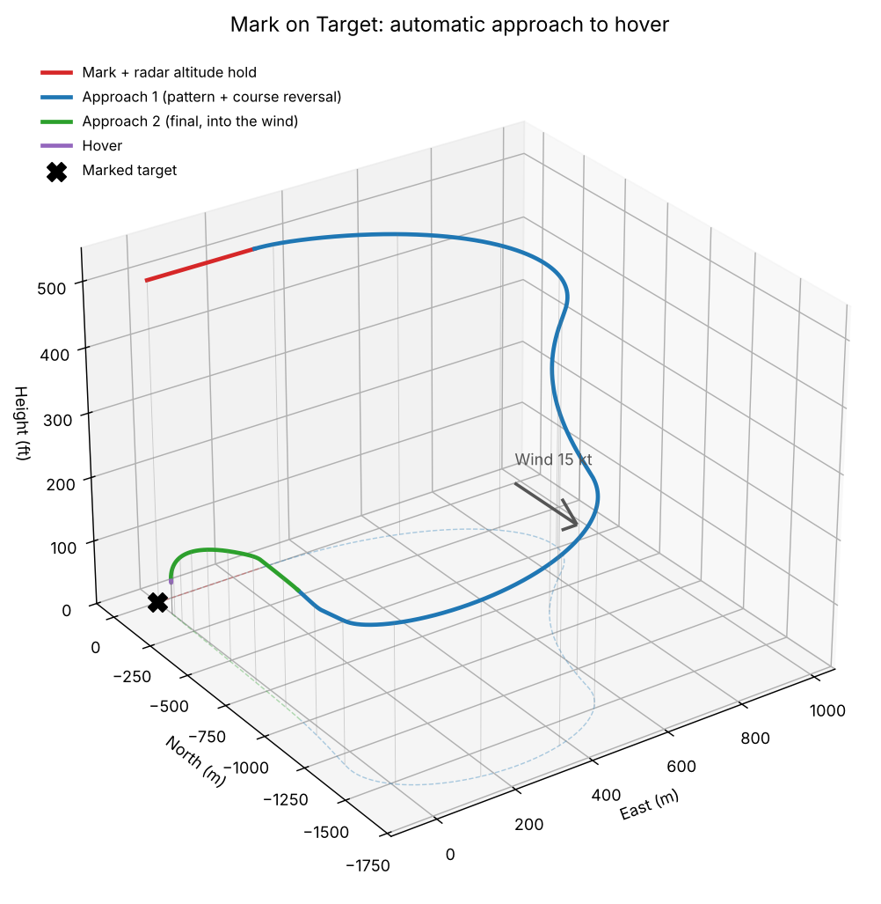
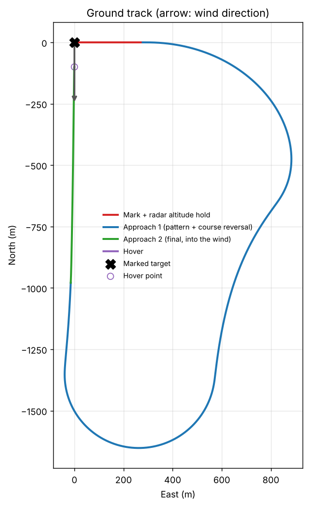
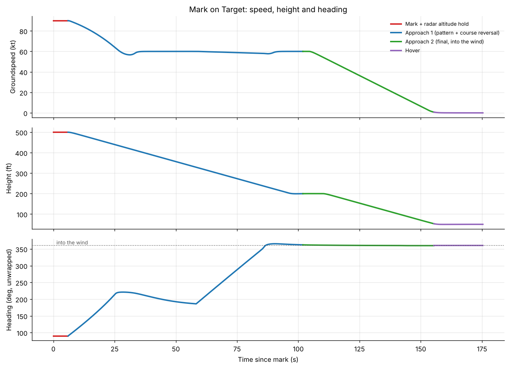
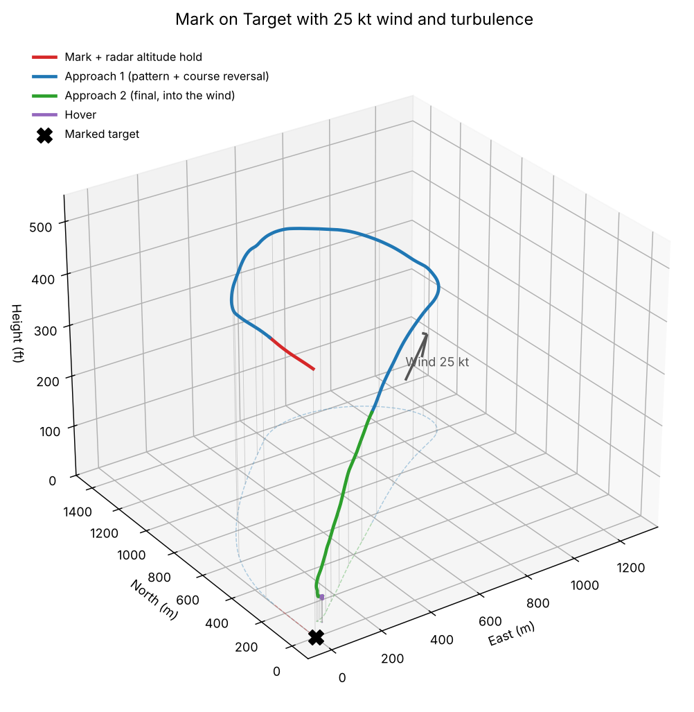

# helicopter-afcs-sim

An open, minimal helicopter simulator to reproduce the trajectory of the **Mark on Target** automatic approach to hover, with its two phases **Approach 1** and **Approach 2**, as flown by the automatic flight control system (AFCS) of search-and-rescue helicopters.

It accompanies my LinkedIn article *"The best school I ever had: control theory on the Black Hawk and Seahawk simulators"*, based on my years (2008–2011) as a software engineer on UH-60 Black Hawk and SH-60 Seahawk simulators.



## What it simulates

The pilot spots a person on the ground or in the water and presses **Mark**. From that moment the AFCS flies the whole manoeuvre:

| Phase | What the helicopter does |
|---|---|
| **Mark** | The target position is stored. Radar altitude hold for a few seconds. |
| **Approach 1** | The pattern: turn downwind on an offset track, decelerate to the gate speed and descend to the gate height, then a course reversal that rolls out on the final course, **into the wind**, through the target. |
| **Approach 2** | The final: constant deceleration (1.2 kt/s) and descent (200 ft/min), timed so that groundspeed and height reach the hover values **at the same moment** over the hover point. |
| **Hover** | Position hold at 50 ft and 0 kt, heading into the wind, about 100 m downwind of the target. |

Rates and the phase structure follow public Sikorsky and avionics-manufacturer descriptions of SAR automatic approaches (see references). The pattern geometry, gains and limits are my own illustrative choices.

<p align="center">
  
  
</p>

## The model

* **Helicopter:** a point mass whose inner loops (SAS, attitude hold) are represented by first-order lags and limits on velocity, heading (bank-limited turn rate, pedal-turn rate in hover) and vertical speed. It is a tool to study **outer-loop modes**, not a rotor or 6-DOF flight model.
* **Mode logic:** a state machine (Mark → Approach 1 → Approach 2 → Hover) wrapped around feedback loops: L1-style cross-track guidance, a constant-deceleration speed profile `v = sqrt(2·a·d)`, a time-to-go descent schedule and a position hold.
* **Wind and turbulence:** the final approach and the hover always face into the wind. Turbulence uses the low-altitude Dryden model of MIL-F-8785C in first-order form, driven by a **Wiener process**:

  ```
  dg = -(V/L) · g · dt + σ · sqrt(2V/L) · dW
  ```

  integrated with the exact Ornstein–Uhlenbeck update, so it is stable for any time step.



## Quick start

```bash
git clone https://github.com/rcolomina/helicopter-afcs-sim.git
cd helicopter-afcs-sim
pip install -e ".[test]"

# wind 15 kt from the north, target marked while flying east
python -m helisim --wind-from 0 --wind-speed 15 --entry-heading 90 --out out/

# 25 kt from the south-west with turbulence
python -m helisim --wind-from 225 --wind-speed 25 --entry-heading 0 --turbulence --seed 4 --out out_turb/

pytest            # 18 tests: hover accuracy, phase order, rates, turbulence statistics
python examples/reproduce_article_figures.py
```

Each run writes `trajectory.csv`, `trajectory_3d.png`, `profiles.png` and `ground_track.png`.

From Python:

```python
from helisim import SimConfig, run_mark_on_target
from helisim.plotting import plot_3d

tr = run_mark_on_target(SimConfig(wind_from_deg=300, wind_speed_kt=20, turbulence=True))
plot_3d(tr, "mot.png")
```

## Project layout

```
helisim/
  params.py     helicopter, mode and simulation parameters
  model.py      point-mass helicopter with response lags
  guidance.py   Mark on Target mode: Mark, Approach 1, Approach 2, Hover
  wind.py       Dryden turbulence driven by a Wiener process
  sim.py        simulation loop, East/North output, CSV export
  plotting.py   3D trajectory, ground track, speed/height/heading profiles
tests/          pytest suite (also run in GitHub Actions)
examples/       script that reproduces the article figures
```

## Disclaimer

This is an educational project built only from public information. It does **not** contain, and is not derived from, any proprietary, export-controlled or classified data, control laws or documentation of any aircraft, AFCS or simulator manufacturer or operator. All numbers are illustrative.

## References

* Sikorsky, *S-92 Search and Rescue Helicopter* brochure: Mark on Target approach phases (Approach 1, Approach 2, Hover, Depart).
* Universal Avionics / Heli-One, *Transition to Hover* (2018): Mark-on-Target, downwind leg, course reversal and hover downwind of the target.
* B. Eddy, *Automatic Flight Control System Honeywell SPZ-7600 for Search and Rescue Helicopters*, SAE Technical Paper 911008, 1991.
* MIL-F-8785C, *Flying Qualities of Piloted Airplanes*: Dryden turbulence model.
* N. Wiener, *Cybernetics: Or Control and Communication in the Animal and the Machine*, 1948.

## License

MIT, see [LICENSE](LICENSE).
